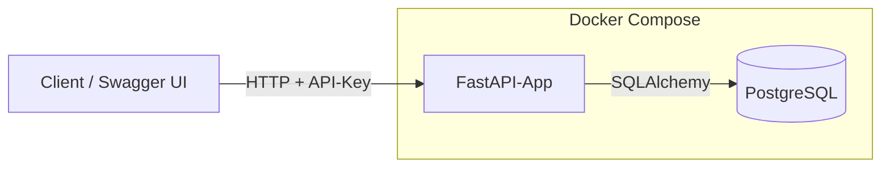
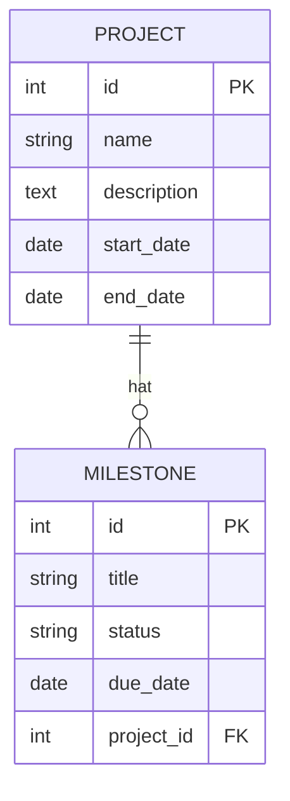
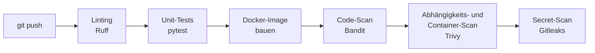

# Fahrzeug-Planer API

Eine REST-API, mit der man Fahrzeugprojekte und ihre Meilensteine planen kann.

Der Schwerpunkt des Projekts liegt auf der CI/CD-Pipeline. Bei jedem Push wird der
Code automatisch geprüft, getestet, als Docker-Image gebaut und auf
Sicherheitsprobleme untersucht.

## Funktionale Anforderungen

Was die API kann:

- Projekte und Meilensteine anlegen, anzeigen, ändern und löschen
- Meilensteine haben einen Status (`planned`, `in_progress`, `done`) und ein Fälligkeitsdatum
- Abfrage, welche Meilensteine überfällig sind
- Zugriff nur mit API-Key
- Prüfung der Eingaben, z. B. darf das Enddatum nicht vor dem Startdatum liegen
- Health-Endpoint und automatisch erzeugte API-Doku (Swagger)
- Logging im JSON-Format

## Nicht-funktionale Anforderungen

Welche Qualitätsziele das Projekt erfüllt und wie:

| Anforderung | Umsetzung |
|---|---|
| Testabdeckung mindestens 70 % | wird bei jedem Push in der Pipeline geprüft |
| Container läuft nicht als root | eigener Benutzer im Dockerfile |
| Schlankes Base-Image | `python:3.13-slim` |
| Keine Passwörter oder Keys im Repository | `.env` steht in `.gitignore`, Gitleaks prüft die Git-Historie |
| Start mit einem Befehl | `docker compose up` |
| Strukturiertes Logging | Logs im JSON-Format |
| Dokumentation | diese README und die Swagger-Doku |

## Tech-Stack

| Bereich | Technik |
|---|---|
| Sprache | Python 3.13 |
| Framework | FastAPI |
| Datenbank | PostgreSQL 17 |
| Datenbankzugriff und Validierung | SQLAlchemy, Pydantic |
| Tests | pytest, pytest-cov |
| Container | Docker, Docker Compose |
| CI/CD | GitHub Actions |
| Code-Qualität | Ruff |
| Security-Scans | Bandit, Trivy, Gitleaks |

## Architektur

Ein Client schickt Anfragen mit API-Key an die App. Die App speichert die Daten in
PostgreSQL. Beide laufen als eigene Container und werden zusammen über
Docker Compose gestartet.

### Datenmodell

Ein Projekt kann beliebig viele Meilensteine haben. Jeder Meilenstein gehört zu
genau einem Projekt. Wird ein Projekt gelöscht, werden seine Meilensteine
automatisch mitgelöscht.

## API-Endpunkte

| Methode | Pfad | Beschreibung |
|---|---|---|
| GET | `/health` | Prüft, ob die App läuft (ohne API-Key) |
| POST | `/projects` | Projekt anlegen |
| GET | `/projects` | Alle Projekte anzeigen |
| GET | `/projects/{id}` | Ein Projekt anzeigen |
| PATCH | `/projects/{id}` | Projekt ändern |
| DELETE | `/projects/{id}` | Projekt löschen |
| POST | `/projects/{id}/milestones` | Meilenstein zu einem Projekt anlegen |
| GET | `/projects/{id}/milestones` | Meilensteine eines Projekts anzeigen |
| GET | `/milestones/overdue` | Überfällige Meilensteine anzeigen |
| GET | `/milestones/{id}` | Einen Meilenstein anzeigen |
| PATCH | `/milestones/{id}` | Meilenstein ändern, z. B. den Status |
| DELETE | `/milestones/{id}` | Meilenstein löschen |

Alle Endpunkte außer `/health` brauchen den Header `X-API-Key`.

Nach dem Start ist die vollständige Doku unter http://localhost:8000/docs erreichbar.
Dort kann man über „Authorize“ den API-Key eingeben und alle Endpunkte direkt
ausprobieren.

## Setup

### Voraussetzungen

- Docker und Docker Compose
- Für die lokale Entwicklung zusätzlich Python 3.13

### Konfiguration

    cp .env.example .env

Danach in `.env` ein eigenes Datenbank-Passwort und einen API-Key eintragen.
Einen sicheren Wert kann man so erzeugen:

    python3 -c "import secrets; print(secrets.token_urlsafe(32))"

| Variable | Bedeutung |
|---|---|
| `POSTGRES_USER` | Benutzername für die Datenbank |
| `POSTGRES_PASSWORD` | Passwort für die Datenbank |
| `POSTGRES_DB` | Name der Datenbank |
| `DATABASE_URL` | Verbindungsadresse der Datenbank für die App |
| `API_KEY` | Schlüssel für den Zugriff auf die API |
| `LOG_LEVEL` | optional, Standard ist `INFO` |

### Starten mit Docker

1. App und Datenbank starten:

       docker compose up -d

2. Prüfen, ob beide Container laufen. Nach etwa 30 Sekunden sollte bei beiden
   `healthy` stehen:

       docker compose ps

3. Im Browser die API-Doku öffnen: http://localhost:8000/docs

4. Oben rechts auf **Authorize** klicken und den `API_KEY` aus der `.env`
   eintragen. Danach lassen sich alle Endpunkte direkt ausprobieren.

5. Zum Beenden:

       docker compose down

   Die Daten bleiben dabei erhalten. Mit `docker compose down -v` wird auch die
   Datenbank gelöscht.

### Lokale Entwicklung

    python3.13 -m venv .venv
    source .venv/bin/activate
    pip install -r requirements-dev.txt

    docker compose up -d db
    uvicorn app.main:app --reload

Wichtig: PostgreSQL speichert das Passwort beim allerersten Start. Wenn man das
Passwort in `.env` später ändert, muss die Datenbank einmal neu angelegt werden.
Dabei werden alle gespeicherten Daten gelöscht:

    docker compose down -v

## Tests und Prüfungen lokal ausführen

    pytest --cov=app
    ruff check .
    bandit -r app --severity-level high

Die Tests nutzen eine SQLite-Datenbank im Arbeitsspeicher. Dafür muss kein
Datenbank-Container laufen.

## CI/CD-Pipeline

Die Pipeline läuft bei jedem Push. Schlägt ein Schritt fehl, bricht sie ab und
die folgenden Schritte werden nicht mehr ausgeführt.

| Schritt | Werkzeug | Was geprüft wird | Bricht ab bei |
|---|---|---|---|
| Linting | Ruff | Code-Stil und typische Programmierfehler | jedem Fund |
| Unit-Tests | pytest | ob die App richtig funktioniert | fehlgeschlagenen Tests oder Abdeckung unter 70 % |
| Image bauen | Docker | ob sich das Image bauen lässt | Fehlern im Dockerfile |
| Code-Scan | Bandit | unsichere Stellen im eigenen Python-Code | Funden mit hohem Schweregrad |
| Abhängigkeits-Scan | Trivy | bekannte Sicherheitslücken in den Python-Paketen | Lücken mit Schweregrad CRITICAL |
| Container-Scan | Trivy | bekannte Sicherheitslücken im fertigen Docker-Image | Lücken mit Schweregrad CRITICAL |
| Secret-Scan | Gitleaks | Passwörter und Keys in der gesamten Git-Historie | jedem Fund |

## Projektstruktur

    app/
      main.py               Startpunkt der App, Logging jeder Anfrage
      config.py             Einstellungen aus Umgebungsvariablen
      database.py           Verbindung zur Datenbank
      auth.py               Prüfung des API-Keys
      logging_config.py     Logging im JSON-Format
      models/               Datenbanktabellen
      schemas/              Ein- und Ausgabeformate mit Validierung
      routes/               API-Endpunkte
    tests/                  Tests
    .github/workflows/      CI/CD-Pipeline
    Dockerfile              Bauplan für den App-Container
    docker-compose.yml      startet App und Datenbank zusammen
    requirements.txt        Pakete für den Betrieb
    requirements-dev.txt    zusätzliche Pakete für Entwicklung und Tests

## Design-Entscheidungen

### Anwendung

| Entscheidung | Warum |
|---|---|
| FastAPI statt Spring Boot | schneller eingerichtet, erzeugt die API-Doku automatisch |
| PostgreSQL in der App, SQLite in den Tests | PostgreSQL ist nah an echter Produktion, SQLite macht die Tests schnell und unabhängig |
| API-Key statt JWT | keine Benutzerkonten nötig, JWT lohnt sich erst bei mehreren Benutzern mit Rechten |
| Datumsprüfung auch beim Ändern | wird nur ein Datum geschickt, muss es mit dem gespeicherten Wert verglichen werden |
| Meilensteine nur innerhalb der Projektlaufzeit | ein Meilenstein nach Projektende ergibt fachlich keinen Sinn |
| „Überfällig“ = Datum vorbei und Status nicht `done` | erledigte Meilensteine sollen nicht als Problem auftauchen |
| `create_all` statt Migrationen | reicht für dieses Projekt, in größeren Projekten würde ich Alembic nutzen |
| Python 3.13 statt 3.15 | für 3.15 gab es noch nicht alle Pakete |

### Sicherheit

| Entscheidung | Warum |
|---|---|
| API-Key-Vergleich mit `secrets.compare_digest` | verhindert, dass man über die Antwortzeit den Schlüssel erraten kann |
| API-Key im Header statt in der URL | URLs landen in Logs und im Browserverlauf |
| Keine Header in den Logs | der API-Key darf nie in Logs landen |
| Logs als JSON | Log-Systeme wie Elasticsearch können die Felder direkt auswerten |
| Sperre nach 5 falschen API-Keys pro Minute | macht Brute-Force-Angriffe praktisch unmöglich |
| Nur Fehlversuche werden gezählt | berechtigte Nutzer werden nie gesperrt |
| Eigene Umsetzung statt Zusatzpaket | jedes neue Paket ist eine mögliche Schwachstelle mehr |
| Zähler im Arbeitsspeicher | reicht für eine Instanz, bei mehreren Instanzen bräuchte man einen gemeinsamen Speicher wie Redis |

### Docker

| Entscheidung | Warum |
|---|---|
| Getrennte Paketlisten für Betrieb und Entwicklung | kleineres Image (392 MB → 332 MB) und weniger Pakete mit möglichen Lücken |
| Container läuft als `appuser` statt `root` | bei einer Lücke hat ein Angreifer nur eingeschränkte Rechte |
| Code im Container nur lesbar | der Code kann im laufenden Container nicht verändert werden |
| Datenbank-Port nur auf `127.0.0.1` | andere Geräte im Netzwerk erreichen die Datenbank nicht |

### Pipeline

| Entscheidung | Warum |
|---|---|
| Schnelle Prüfungen zuerst | bei einem Fehler bricht die Pipeline früh ab und spart Zeit |
| Trivy bricht nur bei CRITICAL ab | die Pipeline wird nur bei ernsten Problemen rot |
| Lücken ohne Patch werden ignoriert | man könnte sie ohnehin nicht beheben |
| Gitleaks scannt die gesamte Git-Historie | auch gelöschte Passwörter stecken noch in alten Commits |
| Pipeline darf das Repo nur lesen | eine manipulierte Action könnte nichts verändern |
| Feste Versionen für Actions | in echten Projekten zusätzlich Commit-Hashes, da Versionsnummern nachträglich geändert werden können |