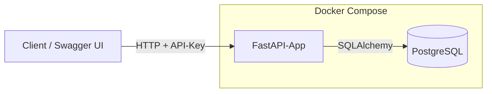
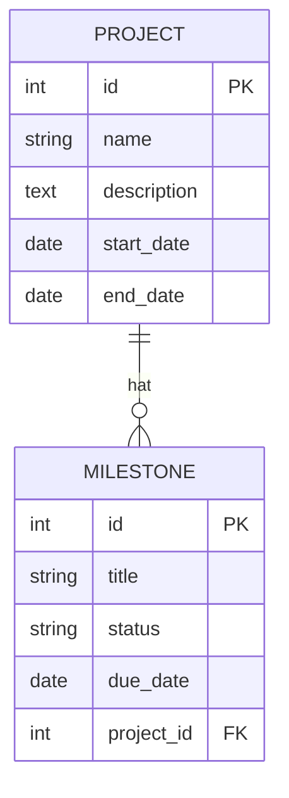
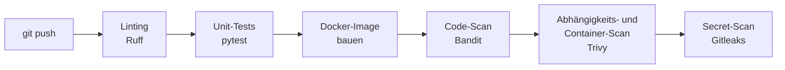

# Fahrzeug-Planer API

REST-API zur Planung von Fahrzeugprojekten und Meilensteinen.

Der Schwerpunkt liegt auf einer CI/CD-Pipeline mit integrierten Security-Checks:
Bei jedem Push wird der Code gelintet, getestet, als Docker-Image gebaut und auf
Schwachstellen, unsichere Abhängigkeiten und versehentlich eingecheckte Secrets
geprüft.

## Funktionale Anforderungen

- Projekte und Meilensteine anlegen, anzeigen, ändern und löschen
- Meilensteine mit Status (`planned`, `in_progress`, `done`) und Fälligkeitsdatum
- Abfrage überfälliger Meilensteine
- Authentifizierung per API-Key
- Eingabevalidierung, z. B. kein Enddatum vor dem Startdatum
- Health-Endpoint und automatisch generierte API-Doku (OpenAPI/Swagger)
- Strukturiertes Logging im JSON-Format

## Nicht-funktionale Anforderungen

| Anforderung | Umsetzung |
|---|---|
| Testabdeckung mindestens 70 % | pytest-cov, wird in der Pipeline geprüft |
| Container läuft nicht als root | eigener Benutzer im Dockerfile |
| Schlankes Base-Image | `python:3.13-slim` |
| Keine Passwörter oder Keys im Repository | `.env` über `.gitignore` ausgeschlossen, Gitleaks in der Pipeline |
| Start mit einem Befehl | `docker compose up` |
| Strukturiertes Logging | Logs im JSON-Format |
| Dokumentation | README mit Architekturdiagramm, Setup und Design-Entscheidungen, Swagger-Doku |

## Tech-Stack

| Bereich | Technik |
|---|---|
| Sprache | Python 3.13 |
| Framework | FastAPI |
| Datenbank | PostgreSQL 17 |
| ORM / Validierung | SQLAlchemy, Pydantic |
| Tests | pytest, pytest-cov |
| Container | Docker, Docker Compose |
| CI/CD | GitHub Actions |
| Security-Scans | Ruff, Bandit, Trivy, Gitleaks |

## Architektur

### Datenmodell

Ein Projekt hat beliebig viele Meilensteine. Wird ein Projekt gelöscht, werden
seine Meilensteine mitgelöscht.

## API-Endpunkte

| Methode | Pfad | Beschreibung |
|---|---|---|
| GET | `/health` | Status der Anwendung (ohne Authentifizierung) |
| POST | `/projects` | Projekt anlegen |
| GET | `/projects` | Alle Projekte anzeigen |
| GET | `/projects/{id}` | Ein Projekt anzeigen |
| PATCH | `/projects/{id}` | Projekt ändern |
| DELETE | `/projects/{id}` | Projekt löschen |
| POST | `/projects/{id}/milestones` | Meilenstein zu einem Projekt anlegen |
| GET | `/projects/{id}/milestones` | Meilensteine eines Projekts anzeigen |
| GET | `/milestones/{id}` | Einen Meilenstein anzeigen |
| PATCH | `/milestones/{id}` | Meilenstein ändern, z. B. Status |
| DELETE | `/milestones/{id}` | Meilenstein löschen |
| GET | `/milestones/overdue` | Überfällige Meilensteine anzeigen |

Alle Endpunkte außer `/health` erwarten den Header `X-API-Key`.

Die vollständige Doku ist nach dem Start unter http://localhost:8000/docs erreichbar.

## Setup

### Voraussetzungen

- Docker und Docker Compose
- Für die lokale Entwicklung zusätzlich Python 3.13

### Konfiguration

    cp .env.example .env

Danach in `.env` ein eigenes Datenbank-Passwort und einen API-Key eintragen.

| Variable | Bedeutung |
|---|---|
| `POSTGRES_USER` | Datenbank-Benutzer |
| `POSTGRES_PASSWORD` | Datenbank-Passwort |
| `POSTGRES_DB` | Name der Datenbank |
| `DATABASE_URL` | Verbindungs-URL für die App |
| `API_KEY` | Schlüssel für den Zugriff auf die API |

### Starten mit Docker

    docker compose up

Die API läuft dann unter http://localhost:8000.

### Lokale Entwicklung

    python3.13 -m venv .venv
    source .venv/bin/activate
    pip install -r requirements.txt

    docker compose up -d db
    uvicorn app.main:app --reload

## Tests

    pytest --cov=app

Die Tests laufen gegen eine SQLite-Datenbank im Arbeitsspeicher und brauchen
keinen laufenden Datenbank-Container. Die Mindestabdeckung liegt bei 70 %.

## CI/CD-Pipeline

| Schritt | Werkzeug | Bricht ab bei |
|---|---|---|
| Linting | Ruff | Stilfehlern und typischen Programmierfehlern |
| Unit-Tests | pytest | fehlgeschlagenen Tests oder Abdeckung unter 70 % |
| Image bauen | Docker | Fehlern im Dockerfile |
| Code-Scan | Bandit | unsicheren Code-Mustern mit hohem Schweregrad |
| Abhängigkeits- und Container-Scan | Trivy | Schwachstellen mit Schweregrad CRITICAL |
| Secret-Scan | Gitleaks | gefundenen Passwörtern, Keys oder Tokens |

## Sicherheitsmaßnahmen

- Keine Zugangsdaten im Repository, alles läuft über Umgebungsvariablen
- Container läuft als eigener Benutzer, nicht als root
- Schlankes Base-Image (`python:3.13-slim`) für eine kleinere Angriffsfläche
- Eingaben werden vor der Verarbeitung validiert
- Automatische Security-Scans bei jedem Push

## Projektstruktur

    app/
      main.py           Startpunkt der Anwendung
      config.py         Einstellungen aus Umgebungsvariablen
      database.py       Datenbankverbindung
      auth.py           Prüfung des API-Keys
      models/           Datenbanktabellen
      schemas/          Ein- und Ausgabeformate inkl. Validierung
      routes/           API-Endpunkte
    tests/              Tests
    .github/workflows/  CI/CD-Pipeline
    Dockerfile
    docker-compose.yml

## Design-Entscheidungen

**FastAPI statt Spring Boot.** Für eine kleine API ist FastAPI schneller aufgesetzt
und erzeugt die OpenAPI-Doku automatisch aus dem Code.

**PostgreSQL in der Anwendung, SQLite in den Tests.** PostgreSQL ist näher an einer
echten Produktionsumgebung. Die Tests nutzen SQLite im Arbeitsspeicher, damit sie
schnell sind und auch in der Pipeline ohne Datenbank-Container laufen.

**API-Key statt JWT.** Die API hat keine Benutzerverwaltung, deshalb reicht ein
API-Key. JWT wäre sinnvoll, sobald es mehrere Benutzer mit unterschiedlichen
Rechten gibt.

**Validierung beim Ändern.** Wird bei einem PATCH nur das Enddatum geschickt,
prüft die API es gegen das gespeicherte Startdatum. Das Schema allein kann das
nicht, weil es den gespeicherten Wert nicht kennt.

**Überfällig** heißt: Das Fälligkeitsdatum liegt in der Vergangenheit und der
Status ist nicht `done`.

**Tabellen über `create_all` statt Migrationen.** Für den Umfang des Projekts reicht
das. In einem echten Projekt würde ich Migrationen mit Alembic einsetzen, damit
sich das Datenbankschema nachvollziehbar ändern lässt.

**Reihenfolge der Pipeline.** Schnelle Prüfungen wie Linting und Tests laufen zuerst.
Schlägt eine davon fehl, bricht die Pipeline früh ab und spart Zeit.

**Python 3.13 statt 3.15.** Zum Projektstart boten noch nicht alle Abhängigkeiten
fertige Pakete für 3.15 an.

## Stand

- [x] Projektgrundlage und Health-Endpoint
- [x] Datenbank mit PostgreSQL per Docker Compose
- [x] CRUD für Projekte mit Datumsvalidierung
- [ ] CRUD für Meilensteine und Abfrage überfälliger Meilensteine
- [ ] Authentifizierung per API-Key
- [ ] Strukturiertes Logging
- [ ] Dockerfile und Start mit `docker compose up`
- [ ] CI/CD-Pipeline mit Security-Scans